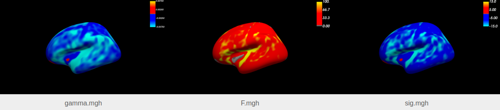

# GLM, mass-univariate

*Part 2 of 4 in the [fsstats tutorial](../TUTORIAL.md). See also: [GLM, univariate](glm_univariate.md).*

## What this analysis is for

Instead of a single volume measure per participant, we now ask the same baseline AD-vs-CN question about cortical thickness at every point (vertex) of the cortical surface. This is a *mass-univariate* analysis: the same ordinary least squares model as [GLM, univariate](glm_univariate.md) is fit independently at each of the (typically tens of thousands of) vertices, rather than once for a single tabular variable. Observations are still independent across participants, so `fsstats_glm` remains the right tool.

Because the OLS fit is closed-form, `fsstats_glm` fits all vertices in a single vectorized computation — it does not use, or expose, a `--cores` option like `fsstats_lme` does (see [LME, mass-univariate](lme_massunivariate.md)); a full-surface analysis typically completes in well under a minute.

## Inputs you need

- `--y`: a concatenated cortical thickness overlay for all participants' baseline visits, resampled to a common template surface, as produced by `mris_preproc`.
- `--surface`: the template surface and hemisphere used for resampling, e.g. `fsaverage lh`.
- `--label` (optional): a FreeSurfer label restricting the analysis to a region of interest, e.g. `lh.cortex.label`, so that non-cortical/medial-wall vertices are skipped. Without it, all vertices are analyzed.
- `--X` and `--C`: the same design matrix and two contrasts as [GLM, univariate](glm_univariate.md) — the model doesn't change, only the outcome data does.
- `--glmdir`: an output directory.

See the [documentation](../DOCUMENTATION.md#input-data-and-format-specifications) for exact format details.

## Building the design matrix and contrasts

Unchanged from [GLM, univariate](glm_univariate.md): intercept, group, age, with `group_contrast.txt` (`0 1 0`) and `age_contrast.txt` (`0 0 1`). The design matrix still has one row per participant — what changes is that `--y` now supplies thousands of outcome columns (one per vertex) instead of the single column read from `--table`.

## Running the command

```bash
fsstats_glm \
--y /my/input/directory/baseline_thickness_lh.mgh \
--label /my/input/directory/lh.cortex.label \
--X /my/input/directory/baseline_design_matrix.txt \
--C /my/input/directory/group_contrast.txt \
--C /my/input/directory/age_contrast.txt \
--surface fsaverage lh \
--glmdir /my/output/directory/glm_massunivariate \
--yhat-save \
--eres-save
```

`--yhat-save` and `--eres-save` are optional; they additionally save the model's fitted signal (`yhat`) and residuals (`eres`) per vertex, which can be useful for diagnostics.

## Understanding the output

The output has the same structure as the univariate case, but every file is a surface overlay (`.mgh`) instead of a text table: `beta.mgh`, `mask.mgh` (the label actually used), and, per contrast (`group_contrast/`, `age_contrast/`), `gamma.mgh`, `F.mgh`, `sig.mgh`, and `z.mgh` — one value per vertex. See [key concepts](../TUTORIAL.md#interpreting-the-output-beta-gamma-f-sig-and-z) for what these represent and how the sign is derived.

These are FreeSurfer-format overlays. View the group effect's signed significance map with Freeview, for example:

```bash
freeview -f fsaverage/surf/lh.inflated:overlay=/my/output/directory/glm_massunivariate/group_contrast/sig.mgh:overlay_threshold=1.3,5
```

This colors the inflated left-hemisphere surface by `sig` (here thresholded to show vertices with sig ≥ 1.3, i.e. p ≤ 0.05): warm/cool colors mark where the effect is positive/negative (AD greater/less than CN, given the sign of `group_contrast`), and color intensity reflects the strength of the effect. `sig.mgh`/`F.mgh` can also be further processed with `surfcluster` for cluster-based summaries.

*(Figure to be added: a Freeview screenshot of contrast estimate, f statistical parameter, and the unthresholded `sig.mgh` overlay for `group_contrast` on the inflated fsaverage surface.)*



**A note on multiple comparisons:** this map contains one test per vertex — the significance map above is *not* corrected for the many comparisons being made at once, and individual vertices should not be interpreted as significant on this basis alone. See [key concepts](../TUTORIAL.md#a-note-on-multiple-comparisons).

See the [documentation](../DOCUMENTATION.md#output-files-and-their-interpretation) for the full output reference.

Next: [LME, univariate](lme_univariate.md), which brings back the repeated visits per participant that this cross-sectional analysis set aside.
