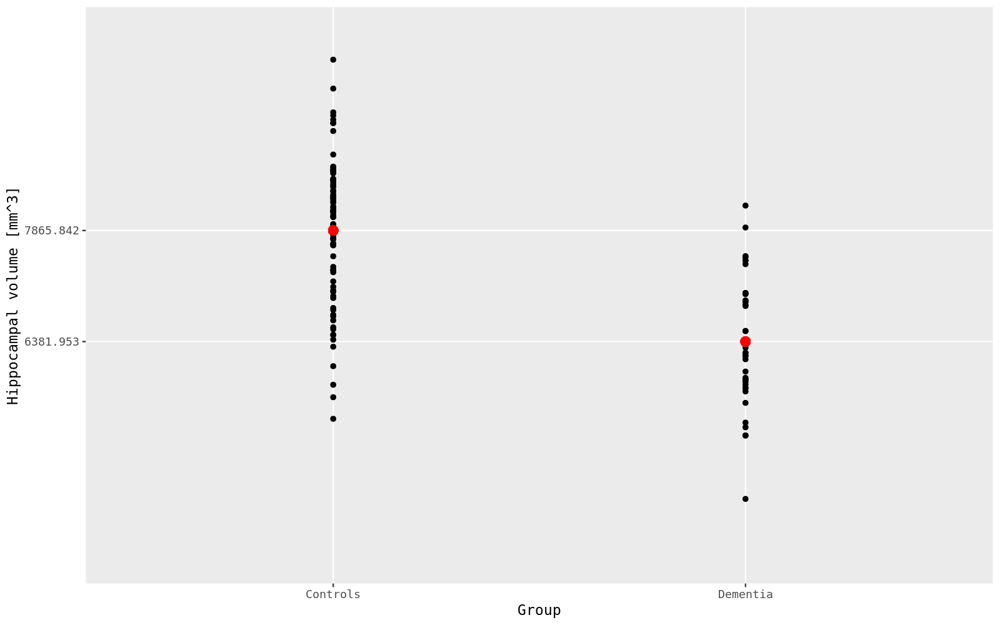
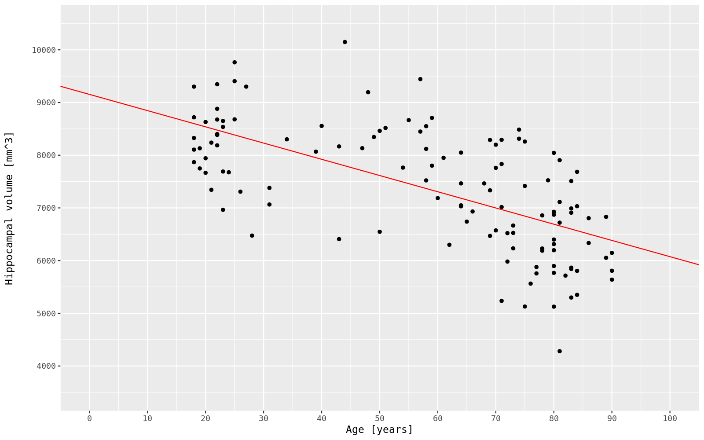

# GLM, univariate

*Part 1 of 4 in the [fsstats tutorial](../TUTORIAL.md). See also: [GLM, mass-univariate](glm_massunivariate.md).*

## What this analysis is for

We start with the simplest version of our [example](tutorial_example): comparing baseline hippocampal volume between the AD and CN groups, using one visit (baseline) per participant. Because each participant contributes a single, independent observation, an ordinary least squares (GLM) model is appropriate — `fsstats_lme`'s clustered/repeated-measures machinery isn't needed here. This is the same kind of comparison FreeSurfer's `mri_glmfit` is used for. See [key concepts](tutorial_key-concepts) if you'd like a reminder of what a GLM, a design matrix, or a contrast is before starting.

## Inputs you need

- `--table`: a table of baseline hippocampal volumes, one row per participant, as produced by `asegstats2table`. Only baseline-visit rows are included. A table can contain more than one column of interest (e.g. hippocampal *and* entorhinal volume together) — each column is then fit and tested independently, and labeled by its column name in the output.
- `--X`: the design matrix (below).
- `--C`: two contrast files (below).
- `--glmdir`: an output directory for `fsstats_glm` to write results into.

See the [documentation](documentation_input-data-format-specs) for the exact expected file format of each.

## Building the design matrix and contrasts

We start with creating the design matrix, which contain all variables the we want to relate to the outcome (or that we want to control for):

- For this cross-sectional comparison, the design matrix has one row per participant and three columns. The first column is the intercept (all 1s), the second column is the group indicator (0 = CN, 1 = AD), and the third column is Age at baseline.

  ```text
  1   0   53
  1   0   47
  1   1   68
  1   0   72
  1   1   81
  ```

We're interested in two questions, so we use two contrasts, each a single row selecting one column:

- Does hippocampal volume differ by group, after accounting for age? Test column 2 (`group_contrast.txt`):
  ```text
  0 1 0
  ```
  The test is an undirected test, i.e. it will detect regions with greater volume in AD cases vs. controls as well as regions with lower volume in the AD cases vs. controls. When looking at the `beta`, `gamma`, `z`, and `sig` values, regions with greater values in the AD group will have a positive sign, and regions with a lower value will have a negative sign.
- Is hippocampal volume associated with age, after accounting for group? Test column 3 (`age_contrast.txt`):
  ```text
  0 0 1
  ```
  This test is also an undirected test, i.e. it will detect positive correlations between age and brain region as well as negative correlations. When looking at the `beta`, `gamma`, `z`, and `sig` values, positive correlations will have a positive sign, and negative correlations will have a negative sign.

Both contrasts are single-row, t-test-like contrasts. If for the first contrast you instead wanted CN-minus-AD to be the "positive" direction for the group effect, you could flip its sign to `0 -1 0` — this changes the sign of the beta, gamma, z, and sig values, but does not change the F-statistic or p-value, only which direction is reported as positive in the signed output (see [key concepts](tutorial_model-outputs)).

>**Note:** This is just one example how to build a statistical design matrix. In practice, you may have more variables / covariates that you are interested in; for example, you could add 'sex' and 'intracranial volume' -- and possibly also selected interaction terms -- as additional columns to the matrix.

## Running the command

```bash
fsstats_glm \
--table /my/input/directory/baseline_hippocampus_table.txt \
--X /my/input/directory/baseline_design_matrix.txt \
--C /my/input/directory/group_contrast.txt \
--C /my/input/directory/age_contrast.txt \
--glmdir /my/output/directory/glm_univariate
```

## Understanding the output

`fsstats_glm` writes results into `/my/output/directory/glm_univariate`:

- `beta.txt` — the fitted regression coefficients (intercept, group effect, age effect).
- `Xg.dat` — the design matrix actually used, for reference.
- One subdirectory per contrast, `group_contrast/` and `age_contrast/`, each containing `gamma.txt`, `F.txt`, `sig.txt`, and `z.txt` for that effect.

See [key concepts](tutorial_model-outputs) for what these mean and how the sign is derived, and the [documentation](documentation_output-files) for the full output reference and the sig/p conversion table.

The following screenshots show plots of baseline hippocampal volume by group, illustrating the effect tested by `group_contrast`, and baseline hippocampal volume by group, illustrating the effect tested by `age_contrast`.





Next: [GLM, mass-univariate](glm_massunivariate.md), which asks the same kind of question but across the whole cortical surface instead of a single region.
