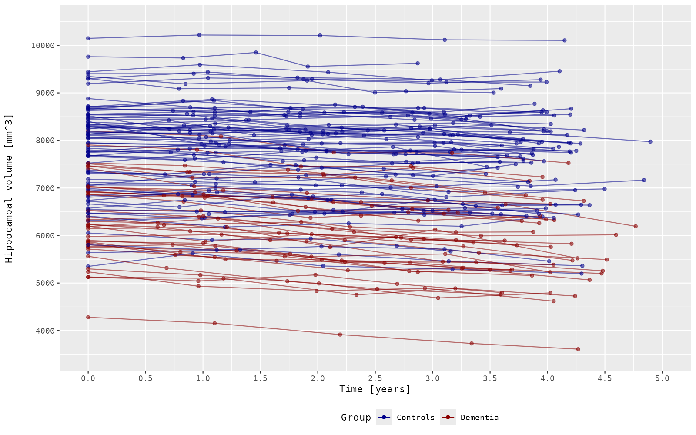
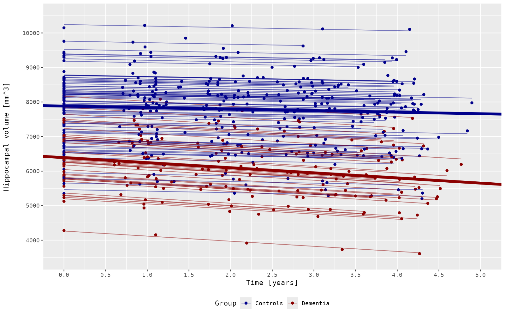

# LME, univariate

*Part 3 of 4 in the [fsstats tutorial](../TUTORIAL.md). See also: [LME, mass-univariate](lme_massunivariate.md).*

## What this analysis is for

Now we use the full longitudinal data: every participant contributes multiple visits, not just baseline. This lets us ask a richer question -- does hippocampal volume *decline over time* differently in AD compared to CN? -- but it also breaks the independence assumption the GLM walkthroughs relied on: visits from the same participant are correlated with each other. A linear mixed-effects (LME) model accounts for this by treating each participant as a random-effects grouping ("cluster"), which is what `fsstats_lme` is for.

### Fixed vs. random effects

The design matrix columns below (intercept, Time, Group, Group×Time) are **fixed effects**: population-average coefficients shared by everyone. `--rfx` additionally designates some of those same columns as **random effects**: each participant gets their own deviation from the fixed-effect average for that column, on top of the shared coefficient. A random intercept lets each participant have their own starting level; a random slope (here, of Time) lets each participant have their own rate of change.

In practice, a random intercept alone (`--rfx 1`) is often the more conservative starting point, especially with only a few visits per participant, since it only requires estimating one deviation per participant. Adding a random slope (`--rfx 1 2`, used below) additionally lets each participant's trajectory over time vary -- appropriate when you expect meaningfully different rates of change across participants, and you have enough visits per participant (typically three or more) to estimate a slope for each of them reliably. With very few timepoints per participant, a random-slope model can become difficult to fit or unstable; a random-intercept-only model is then the safer choice.

## Inputs you need

- `--table`: a table of hippocampal volumes, now with one row per participant *per visit* (so most participants contribute several rows), as produced by `asegstats2table`.
- `--X`: the longitudinal design matrix (below).
- `--C`: two contrast files (below).
- `--rfx`: which columns of `--X` are random effects.
- `--clusters`: a file naming, for each row of `--X`, which participant (case) it belongs to. It must have as many rows as the tables supplied with `--X` and `--table`, and the ordering **must strictly** be the same across `--X`, `--table`, and `--clusters`.
- `--glmdir`: an output directory.

See the [documentation](documentation_input-data-format-specs) for exact format details.

## Building the design matrix and contrasts

We start with creating the design matrix, which contain all variables the we want to relate to the outcome (or that we want to control for):

- For this longitudinal analysis, the design matrix has one row per *visit* (not: per participant) and four columns. The first column is the intercept (all 1s), the second column is Time (years since baseline), the third column is the group indicator (0 = CN, 1 = AD), and the fourth column is the Group × Time interaction. The interaction term is the product of the values of the second and third columns; it is needed to assess potential differences in the slope across time between the groups. Note that the number of observations does not need to be the same across participants, and that follow-up intervals do not need to be identical across participants. 

  ```text
  1   0.0   1   0.0
  1   1.3   1   1.3
  1   2.7   1   2.7
  1   0.0   0   0.0
  1   2.1   0   0.0
  1   0.0   0   0.0
  1   0.0   1   0.0
  1   0.5   1   0.5
  1   1.8   1   1.8
  1   2.5   1   2.5
  ```

- To identify which observations in the design matrix come from the same person, we need the `--clusters` file. Here, we specify that the above design matrix has observations from four cases with 3, 2, 1, and 4 visits, respectively. The case IDs that are used in this file can be arbitrary alphanumerical values, as long as identical values refer to identical cases.

  ```text
  001
  001
  001
  002
  002
  003
  004
  004
  004
  004
  ```

- We treat both the intercept and the slope of time as random effects, per the discussion above:

  ```text
  --rfx 1 2
  ```

Two questions, two contrasts:

- Does baseline volume differ by group? Test column 3:
  ```text
  0 0 1 0
  ```
- Does the slope across time differ by group? Test column 4:
  ```text
  0 0 0 1
  ```

## Running the command

```bash
fsstats_lme \
--table /my/input/directory/longitudinal_hippocampus_table.txt \
--X /my/input/directory/longitudinal_design_matrix.txt \
--C /my/input/directory/group_contrast.txt \
--C /my/input/directory/group_by_time_contrast.txt \
--clusters /my/input/directory/case_ids.txt \
--rfx 1 2 \
--glmdir /my/output/directory/lme_univariate
```

## Understanding the output

`fsstats_lme` writes results into `/my/output/directory/lme_univariate`:

- `beta.txt` -- the fitted fixed-effects coefficients.
- One subdirectory per contrast (`group_contrast/`, `group_by_time_contrast/`), each with `gamma.txt`, `F.txt`, `sig.txt`, and `z.txt` -- same meaning as in the GLM walkthroughs (see [key concepts](tutorial_model-outputs)).

The `group_by_time_contrast/sig.txt` result is the one that answers our motivating question: whether AD and CN differ in their rate of hippocampal decline.

`fsstats` also fits per-case random-effects estimates (each participant's individual deviation from the fixed-effect intercept and slope) as part of a univariate analysis, but the command-line tools do not currently write these to an output file -- only the fixed-effects results described above are exported.

`fsstats_lme` caches the fitted model internally, so if you later want to evaluate additional contrasts against this same fit without re-running the (for a univariate analysis, quick) estimation step, you can add `--skip-estimation` on a subsequent run with the same `--glmdir`.

*(Figure to be added: individual hippocampal-volume trajectories over time, one line per participant, colored by group, with fitted average trends overlaid.)*





Next: [LME, mass-univariate](lme_massunivariate.md), which asks this same longitudinal question across the whole cortical surface.
